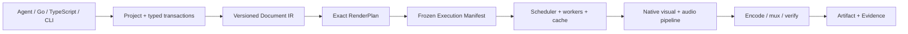

<div align="center">

# Cutly

**Edit deterministically. Render natively. Built for agents.**

A Chrome-free video editing SDK built on versioned documents, exact time,
typed edits, and verifiable renders.

[Quick Start](#quick-start) · [How It Works](#how-it-works) ·
[SDKs](#sdks-and-tools) · [Roadmap](docs/DOCUMENT_V2_NATIVE_SDK_ROADMAP.md) ·
[Examples](examples/) · [Limitations](KNOWN_LIMITATIONS.md)

[](CHANGELOG.md)
[](go.mod)
[](sdk/typescript/package.json)
[](LICENSE)

</div>

Cutly is an open-source toolkit for building AI video editors, embedded
editing products, and automated media pipelines. Instead of treating React,
HTML, or a browser page as the project database, Cutly uses a typed,
versioned Document IR. Agents edit that document through reviewable
transactions; renderers consume frozen plans and emit evidence-bound
artifacts.

The current `0.1.0-rc.1` source includes a production-tested **restricted
hard-cut path** plus deterministic native reference renderers for images,
vectors, static text, and audio. The broader Document v2 mixed-media runtime
is being delivered in audited stages. See [Current Status](#current-status)
before choosing a production profile.

> [!IMPORTANT]
> Cutly is not yet a general nonlinear editor. Unsupported semantics fail
> during plan, prepare, or preflight; they never silently fall back to an
> approximate renderer. The exact RC boundary is documented in
> [KNOWN_LIMITATIONS.md](KNOWN_LIMITATIONS.md).

## Quick Start

### Build from source

Requirements: Go 1.25+, Node.js 20+, and FFmpeg/FFprobe for real-media render
tests.

```bash
git clone --branch codex/video-sdk-core https://github.com/CutlyLab/Cutly.git
cd Cutly

go build -o ./bin/cutly ./cmd/cutly
go build -o ./bin/cutlyd ./cmd/cutlyd

./bin/cutly version
./bin/cutly --help
```

Expected version output:

```text
cutly 0.1.0-rc.1 (agent protocol v1)
```

### Verify the SDK

```bash
go test ./...
go vet ./...
npm --prefix sdk/typescript test
```

For the complete race, packaging, cross-platform, and real-media gates, see
[Development](#development).

### Render through the public RC path

The runnable Go and TypeScript examples exercise the complete supported flow:

```text
durable project → plan → host prepare → fresh-probe preflight
                → durable render job → H.264/AAC MP4 + evidence
```

Start with [examples/README.md](examples/README.md). It covers project
initialization, the host-owned FFmpeg identities required by `cutlyd`, input
authorization, exact-frame preview, render submission, recovery, and artifact
validation.

## With an AI Agent

Cutly is designed so an agent never needs to rewrite a project file or invent
renderer state. The safe loop is explicit:

```text
inspect → plan typed transaction → review diff → apply by transaction ID
        → prepare → preflight → render → verify evidence
```

Once `cutlyd` is running, Go, TypeScript, CLI, or any HTTP-capable agent can
use the same bounded Agent protocol at `/v1/agent`.

Try a request like:

> Inspect project `demo`, plan a trim of clip `intro` to five seconds, show
> the exact transaction and render impact, and wait for approval before
> applying it.

The host—not the agent—owns filesystem roots, media probes, executable
digests, runtime fingerprints, and publication policy.

## What You Can Build

- AI editing assistants with plan/apply/revert semantics
- Local-first or self-hosted video automation
- Batch template and media transformation pipelines
- Embedded headless players and timeline primitives
- Deterministic frame, vector, text, and audio regression systems
- Private-media workflows where Chrome is not an acceptable base dependency
- Auditable render services with durable jobs, recovery, and evidence

## How It Works



Cutly separates semantic truth from execution choices:

1. **Document** — stable IDs, exact ranges, typed properties, keyframes,
   transitions, text, vectors, and audio routing.
2. **Transaction** — atomic, revision-checked edits with idempotency and an
   inverse for revert.
3. **RenderPlan** — backend-neutral meaning: selected timeline, visible
   ranges, clocks, capabilities, and logical resources.
4. **ExecutionManifest** — host-owned materialization, runtime, provider,
   output, and implementation identities.
5. **RenderJob** — durable scheduling, retry, cancellation, checkpoint, and
   publication state.
6. **Evidence** — decoded-domain roots and artifact bindings that can be
   validated independently of a successful process exit.

The native reference surface is linear-light BT.709 premultiplied RGBA16.
Frame and sample selection use exact rational clocks; fingerprints use strict
canonical integer JSON.

## Current Status

| Surface | Status | Current boundary |
| --- | --- | --- |
| Restricted native MP4 path | **Available in RC source** | One continuous video track + one continuous audio track, hard cuts, H.264/AAC through host-owned FFmpeg |
| Durable project and Agent workflow | **Available in RC source** | Inspect, plan, apply, discard, revert, prepare, preflight, frame, render, status, cancel |
| Scheduler and recovery | **Available in RC source** | Durable queue, whole-job checkpoint/replay, final-artifact CAS, publication recovery |
| Native image/vector/static-text reference pixels | **Available as deterministic reference stages** | RGBA16 composition, exact transforms/crop/opacity, deterministic PNG, strict receipts |
| Reference audio | **Available as deterministic reference stages** | Exact AudioGraph, WAV source, PCM16LE quantization, deterministic WAV |
| Document v2 semantic RenderPlan | **Implemented and audited** | Additive `core/renderplanv2`; fixed schemas, fixtures, hostile corpus, cross-target gates |
| Document v2 ExecutionManifest/RenderRequest | **Implemented; final independent audit pending** | Portable identity and host authorization exist; do not enter restart reconstruction yet |
| General mixed video/audio Document v2 export | **In progress** | Native temporal video providers, Prepared v2, chunk assembly, and Evidence v2 remain roadmap stages |
| Public Document v2 edit/render SDKs | **Planned** | Current public edit/render lifecycle is the restricted RC profile |
| Optional browser/WebLayer | **Deferred** | Native rendering remains the default; browser layers are a later isolated capability |

Stage evidence is recorded in
[Document v2 S1](docs/DOCUMENT_V2_S1_EVIDENCE.md) and
[Document v2 S2](docs/DOCUMENT_V2_S2_EVIDENCE.md). The full dependency-ordered
plan lives in [DOCUMENT_V2_NATIVE_SDK_ROADMAP.md](docs/DOCUMENT_V2_NATIVE_SDK_ROADMAP.md).

## Why Cutly?

- **Agent-first edits** — agents propose typed operations; they do not mutate
  opaque JSON, HTML, or renderer code.
- **Native by default** — Chrome is not required for the base video, image,
  vector, text, audio, or scheduling architecture.
- **Exact time** — rational timeline time, composition frame clocks, and
  sample clocks avoid floating-point drift.
- **Fail closed** — unsupported features, stale revisions, identity drift,
  malformed wire data, and unsafe resources produce stable errors.
- **Deterministic reference stages** — canonical pixels, PCM, receipts,
  fixtures, and golden hashes make regression testing practical.
- **Host-owned trust** — media authorization and executable/runtime identity
  remain outside Agent-controlled payloads.
- **Embeddable surfaces** — Go engine, TypeScript client, CLI, daemon,
  headless Player, and timeline primitives share the same contracts.
- **Open source** — Apache 2.0, with no per-render fee in the SDK.

## Cutly and Browser-First Video Frameworks

Cutly is a different architectural bet, not a drop-in replacement for
web-native motion-graphics tools such as
[HyperFrames](https://github.com/heygen-com/hyperframes) or
[Remotion](https://github.com/remotion-dev/remotion).

| | Cutly | Browser-first frameworks |
| --- | --- | --- |
| Canonical project | Versioned typed Document IR | React/HTML/code composition |
| Primary use | Media editing, automation, embedded products | Web-native motion graphics and programmable scenes |
| Default pixel path | Native evaluator/compositor | Headless browser capture |
| Agent writes | Typed transactions and reviewed plans | Source code or markup |
| Time | Exact rational frame/sample clocks | Frame or seconds-based runtime APIs |
| Browser | Optional future isolated layer | Core rendering dependency |
| Verification | Protocol fixtures, decoded roots, evidence | Controlled runtime and frame regression |

The two approaches can coexist: a future Cutly WebLayer can contribute a
bounded transparent surface without becoming the project database or base
media engine.

## SDKs and Tools

| Surface | Path | What it provides |
| --- | --- | --- |
| Go SDK | [`sdk/go/cutly`](sdk/go/cutly/) | Public models, strict decoders, Agent client, HTTP transport, render/job validation |
| TypeScript SDK | [`sdk/typescript`](sdk/typescript/) | Dependency-free client, canonical integer JSON, receipts, HeadlessPlayer, timeline/UI primitives |
| CLI | [`cmd/cutly`](cmd/cutly/) | Project, edit, render, canonicalize, doctor, and generic Agent calls |
| Local daemon | [`cmd/cutlyd`](cmd/cutlyd/) | Host policy, durable projects/jobs, media preparation, FFmpeg execution, artifact recovery |
| Core | [`core`](core/) | Documents, exact time, transactions, evaluator, Document v2 semantic plans |
| Render | [`render`](render/) | Native pixels/PCM, providers, compositor, scheduler, cache/checkpoint, FFmpeg backend |
| Schemas | [`schemas`](schemas/) | Versioned public JSON Schemas |
| Conformance | [`conformance`](conformance/) | Shared canonical, valid, invalid, and hostile protocol fixtures |

## Go SDK

```go
package main

import (
    "context"
    "log"

    cutly "github.com/CutlyLab/Cutly/sdk/go/cutly"
)

func main() {
    transport, err := cutly.NewHTTPTransport(
        "http://127.0.0.1:9817/v1/agent",
        nil,
    )
    if err != nil {
        log.Fatal(err)
    }

    client, err := cutly.NewClient(transport)
    if err != nil {
        log.Fatal(err)
    }

    result, err := client.InspectProject(
        context.Background(),
        "inspect-42",
        "demo",
    )
    if err != nil {
        log.Fatal(err)
    }
    log.Printf("ok=%v receipt=%s", result.OK, result.Receipt)
}
```

See the [Go SDK guide](sdk/go/README.md) for typed edit, prepare, preflight,
frame, render, status, and receipt-validation examples.

## TypeScript SDK

```js
import { CutlyClient, HTTPAgentTransport } from "@cutly/sdk";

const client = new CutlyClient(
  new HTTPAgentTransport("http://127.0.0.1:9817/v1/agent"),
);

const result = await client.inspectProject({
  requestId: "inspect-42",
  projectId: "demo",
});

console.log(result.ok, result.receipt);
```

The npm package is prepared in source but is not claimed as publicly
published yet. See the [TypeScript SDK guide](sdk/typescript/README.md) and
[release checklist](RELEASING.md).

## Documentation

| Document | Purpose |
| --- | --- |
| [Examples](examples/README.md) | Complete Go and TypeScript RC render flows |
| [Known limitations](KNOWN_LIMITATIONS.md) | Exact supported and rejected media semantics |
| [Compatibility](docs/COMPATIBILITY.md) | Wire-version, SemVer, and deprecation policy |
| [Document v2 roadmap](docs/DOCUMENT_V2_NATIVE_SDK_ROADMAP.md) | Dependency-ordered path to the broad native SDK |
| [M4 release readiness](docs/M4_RELEASE_READINESS.md) | Restricted RC acceptance evidence and external release gates |
| [Schema catalog](schemas/README.md) | Public JSON Schemas and conformance inventory |
| [Security](SECURITY.md) | Vulnerability reporting |
| [Release process](RELEASING.md) | Tags, archives, npm provenance, checksums, and attestations |

## Development

Run the complete local gates from the repository root:

```bash
go mod tidy -diff
go vet ./...
go test -race -count=1 ./...

npm --prefix sdk/typescript test
npm --prefix sdk/typescript run pack:check
```

The full race suite includes the HTTP daemon and may require permission to
bind a local loopback port. Real render tests require FFmpeg and FFprobe.

The repository also freezes schemas, canonical fixtures, dependency licenses,
an SPDX SBOM, portable command builds, and release provenance. New behavior
must use an additive profile or schema; published wire semantics are never
reinterpreted in place.

## Security

Do not report vulnerabilities through public issues. Follow
[SECURITY.md](SECURITY.md). Cutly treats media locators, executable identity,
filesystem confinement, output publication, and Agent envelopes as security
boundaries.

## License

[Apache License 2.0](LICENSE)
