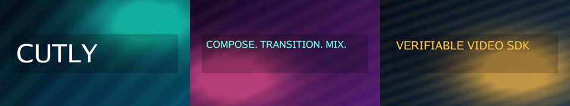
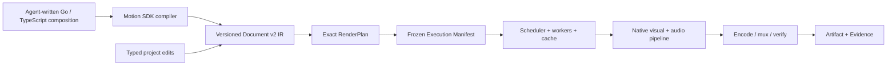

<div align="center">


**Edit deterministically. Render natively. Built for agents.**

A Chrome-free video editing SDK built on versioned documents, exact time,
typed edits, and verifiable renders.

<!-- CUTLY_LAUNCH_FILM -->
https://github.com/user-attachments/assets/dddd4cf1-ead7-4894-86bd-3c5ed1ac3346
<!-- /CUTLY_LAUNCH_FILM -->

**[Watch the 21-second Cutly launch film](videos/cutly-launch/renders/cutly-launch.mp4)**

[Quick Start](#quick-start) · [Architecture](#how-it-works) ·
[SDKs](#sdks-and-tools) · [CLI](#cli-and-daemon) · [Status](#current-status) ·
[Examples](examples/) · [Documentation](#documentation)

[](CHANGELOG.md)
[](https://github.com/CutlyLab/Cutly/actions/workflows/ci.yml)
[](go.mod)
[](sdk/typescript/package.json)
[](LICENSE)

</div>

Cutly is an open-source toolkit for building AI video editors, embedded
editing products, and automated media pipelines. An agent or developer writes
video composition code in TypeScript or Go. The Motion SDK compiles that source
to a typed, versioned Document IR; the native renderer consumes frozen plans
and emits evidence-bound artifacts. Existing projects remain safely editable
through reviewable transactions.

The current `0.1.0-rc.1` source includes the frozen restricted hard-cut path
and the standalone Document v2 SDK: typed durable edits, native mixed-media
providers, isolated workers, chunk cache/recovery, H.264/AAC assembly,
Evidence v2, Go/TypeScript clients, CLI, Agent v2, and headless Player/UI
primitives. Production use still requires an owner-approved signed media
runtime and the release acceptance described in [RELEASING.md](RELEASING.md).

> [!IMPORTANT]
> Cutly is not yet a general nonlinear editor. Unsupported semantics fail
> during plan, prepare, or preflight; they never silently fall back to an
> approximate renderer. The exact RC boundary is documented in
> [KNOWN_LIMITATIONS.md](KNOWN_LIMITATIONS.md).

## At a Glance

| | Current source |
| --- | --- |
| Maturity | `0.1.0-rc.1`; M4 standalone SDK source complete, tagged production release pending |
| License | Apache-2.0 |
| Primary API | Code-first Motion SDK in Go or TypeScript, plus CLI and `/v2/agent` HTTP |
| Project model | Composition source → compiled Document v2, with atomic Plan → Apply → Revert edits |
| Rendering | Native, Chrome-free video/image/vector/static-text/audio pipeline |
| Output | H.264/AAC MP4 plus independently verifiable Evidence v2 |
| Time model | Exact rational frame and sample clocks; no floating-point timeline identity |
| Runtime model | Local/self-hosted; media paths, executables and trust policy remain host-owned |
| Production targets | Linux and macOS; see [Platform Support](#platform-support) |

Cutly deliberately does **not** bundle an arbitrary FFmpeg build, expose
filesystem authority to an Agent, or treat a successful encoder exit as proof
that the requested media was produced.

## Native Rendering Proof

[](videos/cutly-native-demo/cutly-native-demo.mp4)

**[Play the 6-second demo rendered by Cutly](videos/cutly-native-demo/cutly-native-demo.mp4)** —
three image assets, vector composition, pinned-font text, keyframed opacity,
two dissolves, an audio bus and limiter, H.264/AAC output, and Evidence v2.

[Evidence](videos/cutly-native-demo/cutly-native-demo.mp4.evidence.json) ·
[Render metadata](videos/cutly-native-demo/cutly-native-demo.metadata.json)

## Quick Start

### 1. Clone and build

Requirements: Go 1.25+, Node.js 20+, and FFmpeg/FFprobe for real-media render
tests.

```bash
git clone https://github.com/CutlyLab/Cutly.git
cd Cutly

go build -o ./bin/cutly ./cmd/cutly
go build -o ./bin/cutlyd ./cmd/cutlyd
go build -o ./bin/cutly-worker-v2 ./cmd/cutly-worker-v2

./bin/cutly version
./bin/cutly --help
```

Expected version output:

```text
cutly 0.1.0-rc.1 (Document v2 Agent schema 2; legacy Agent protocol v1)
```

### 2. Verify the checkout

```bash
go test ./...
go vet ./...
npm --prefix sdk/typescript test
```

For the complete race, packaging, cross-platform, and real-media gates, see
[Development](#development).

### 3. Use the SDK as a dependency

The Go façade is part of the root module. Until a public tag is published,
pin an audited commit rather than depending on a moving branch:

```bash
go get github.com/CutlyLab/Cutly/sdk/go/cutly@<tag-or-commit>
```

The TypeScript package is dependency-free and prepared for npm publication.
Before the first public npm release, build and install the exact local tarball:

```bash
npm pack ./sdk/typescript
npm install ./cutly-sdk-0.1.0-rc.1.tgz
```

See the [Go SDK guide](sdk/go/README.md) and
[TypeScript SDK guide](sdk/typescript/README.md) for complete client examples.

### 4. Write a video as code

Agents and developers author composition source; Cutly generates Document v2:

```js
import { createMotionCompositionV2 } from "@cutly/sdk";

const film = createMotionCompositionV2({
  id: "launch", width: 1920, height: 1080, fps: 30, durationFrames: 150,
});

film.rectangleAsset({
  id: "panel", width: 1920, height: 1080,
  fill: { r: 1200, g: 1600, b: 2200, a: 65535 },
});

film.scene("hook", { durationFrames: 150 }, (scene) => {
  scene.shape("panel", "panel")
    .animateScale([
      { frame: 0, value: ["0.96", "0.96"], easing: "power2.inOut" },
      { frame: 150, value: ["1.04", "1.04"] },
    ]);
});

const document = film.build();
```

Run the repository example and produce canonical Document v2 JSON:

```bash
node ./examples/typescript-motion-composition.mjs > ./launch.document.json
```

See the [TypeScript Motion guide](sdk/typescript/README.md) and
[Go Motion guide](sdk/go/README.md) for text, images, audio, exact keyframes
and easing.

### 5. Render through the public RC path

The runnable Go and TypeScript examples exercise the complete supported flow:

```text
durable project → plan → host prepare → fresh-probe preflight
                → durable render job → H.264/AAC MP4 + evidence
```

Start with [examples/README.md](examples/README.md). It covers project
initialization, the host-owned FFmpeg identities required by `cutlyd`, input
authorization, exact-frame preview, render submission, recovery, and artifact
validation.

## CLI and Daemon

The CLI defaults to the Document v2 profile. Every mutating operation is
explicit; planning never applies an edit by itself.

```text
cutly init         Create a durable Document v2 or legacy-v1 project
cutly doctor       Check the selected Agent endpoint and installed routes
cutly project      Inspect status, history and capabilities
cutly edit         Plan, apply, discard or revert a typed transaction
cutly render       Plan, prepare, preflight, preview, submit or inspect a render
cutly call         Send a strict Agent request envelope
cutly canonicalize Validate and canonicalize the integer JSON wire profile
```

Run `cutly --help` for action names and exit codes. `cutlyd` is the loopback
host process: it owns project state, authorized media roots, prepared
environments, the scheduler, workers, cache, FFmpeg runtime and artifact
publication. Rendering is opt-in and requires physically separate project,
input, state and output roots.

> [!WARNING]
> `cutlyd` is a local Agent daemon, not an internet authentication gateway.
> Keep it on loopback or place it behind your own authenticated transport.
> Never accept runtime trust keys, executable digests or arbitrary filesystem
> roots from an Agent request.

The exact daemon flags and development-runtime boundary are documented in
[cmd/cutlyd/README.md](cmd/cutlyd/README.md).

## With an AI Agent

For a new video, the agent writes normal Motion SDK source. Cutly compiles that
source into Document v2 and keeps renderer state out of the authored program:

```text
agent-written composition.ts / composition.go
        → Motion SDK compiler → Document v2
        → native render plan → MP4 + Evidence v2
```

For later edits to a durable project, the safe loop is explicit:

```text
inspect → plan typed transaction → review diff → apply by transaction ID
        → prepare → preflight → render → verify evidence
```

Once `cutlyd` is running, Go, TypeScript, CLI, or any HTTP-capable agent can
use the Document v2 Agent protocol at `/v2/agent`. The frozen restricted
profile remains available explicitly at `/v1/agent`.

Try a request like:

> Inspect project `demo`, plan a trim of clip `intro` to five seconds, show
> the exact transaction and render impact, and wait for approval before
> applying it.

The host—not the agent—owns filesystem roots, media probes, executable
digests, runtime fingerprints, and publication policy.

## What You Can Build

- AI editing assistants with plan/apply/revert semantics
- Local-first or self-hosted video automation
- Batch template and media transformation pipelines
- Embedded headless players and timeline primitives
- Deterministic frame, vector, text, and audio regression systems
- Private-media workflows where Chrome is not an acceptable base dependency
- Auditable render services with durable jobs, recovery, and evidence

## How It Works



Cutly separates semantic truth from execution choices:

1. **Document** — stable IDs, exact ranges, typed properties, keyframes,
   transitions, text, vectors, and audio routing.
2. **Transaction** — atomic, revision-checked edits with idempotency and an
   inverse for revert.
3. **RenderPlan** — backend-neutral meaning: selected timeline, visible
   ranges, clocks, capabilities, and logical resources.
4. **ExecutionManifest** — host-owned materialization, runtime, provider,
   output, and implementation identities.
5. **RenderJob** — durable scheduling, retry, cancellation, checkpoint, and
   publication state.
6. **Evidence** — decoded-domain roots and artifact bindings that can be
   validated independently of a successful process exit.

The native reference surface is linear-light BT.709 premultiplied RGBA16.
Frame and sample selection use exact rational clocks; fingerprints use strict
canonical integer JSON.

## Current Status

| Surface | Status | Current boundary |
| --- | --- | --- |
| Restricted native MP4 path | **Available in RC source** | One continuous video track + one continuous audio track, hard cuts, H.264/AAC through host-owned FFmpeg |
| Durable project and Agent workflow | **Available in RC source** | Inspect, plan, apply, discard, revert, prepare, preflight, frame, render, status, cancel |
| Scheduler and recovery | **Available in RC source** | Durable queue, whole-job checkpoint/replay, final-artifact CAS, publication recovery |
| Native image/vector/static-text reference pixels | **Available as deterministic reference stages** | RGBA16 composition, exact transforms/crop/opacity, deterministic PNG, strict receipts |
| Reference audio | **Available as deterministic reference stages** | Exact AudioGraph, WAV source, PCM16LE quantization, deterministic WAV |
| Document v2 semantic RenderPlan | **Implemented and audited** | Additive `core/renderplanv2`; fixed schemas, fixtures, hostile corpus, cross-target gates |
| Document v2 ExecutionManifest/RenderRequest | **Implemented and audited** | Portable identity, strict verification, host authorization and restart reconstruction are covered by conformance and hostile-input tests |
| General mixed video/audio Document v2 export | **Implemented; release trust pending** | Temporal video/image/vector/text/audio providers, Prepared v2, chunk workers, H.264/AAC assembly and Evidence v2 |
| Public Document v2 edit/render SDKs | **Implemented** | Go/TypeScript APIs, default-v2 CLI, `/v2/agent`, strict fixtures and durable project edits |
| Document v2 Player/UI | **Implemented headlessly** | Exact audio-master player, bound frame/audio preview adapters and immutable mixed-media timeline primitives |
| Optional browser/WebLayer | **Deferred** | Native rendering remains the default; browser layers are a later isolated capability |

Stage evidence is recorded for
[S1](docs/DOCUMENT_V2_S1_EVIDENCE.md),
[S2](docs/DOCUMENT_V2_S2_EVIDENCE.md),
[S3](docs/DOCUMENT_V2_S3_EVIDENCE.md),
[S4](docs/DOCUMENT_V2_S4_EVIDENCE.md),
[S5](docs/DOCUMENT_V2_S5_EVIDENCE.md),
[S6](docs/DOCUMENT_V2_S6_EVIDENCE.md), and
[S7a](docs/DOCUMENT_V2_S7A_EVIDENCE.md). The dependency-ordered history and
remaining release-owner gates live in the
[Document v2 roadmap](docs/DOCUMENT_V2_NATIVE_SDK_ROADMAP.md).

## Platform Support

| Target | Build | Native render runtime | Notes |
| --- | --- | --- | --- |
| Linux `amd64` / `arm64` | Supported | Release target | Requires an approved signed FFmpeg/FFprobe bundle |
| macOS `amd64` / `arm64` | Supported | Release target | Requires an approved signed FFmpeg/FFprobe bundle |
| Windows `amd64` | Supported | Fails closed in this RC | Secure inherited-handle runtime confinement is not yet equivalent |
| FreeBSD `amd64` | Supported | Not a release runtime target | Portable build coverage only |
| `js/wasm` | Protocol/core compile coverage | No native render runtime | Useful for compatibility checks, not media execution |

The TypeScript SDK requires Node.js 20 or newer. Platform compilation does not
imply that an encoder, codec, signed runtime or capability is installed; clients
must inspect capabilities and complete preflight.

## Why Cutly?

- **Agent-first edits** — agents propose typed operations; they do not mutate
  opaque JSON, HTML, or renderer code.
- **Native by default** — Chrome is not required for the base video, image,
  vector, text, audio, or scheduling architecture.
- **Exact time** — rational timeline time, composition frame clocks, and
  sample clocks avoid floating-point drift.
- **Fail closed** — unsupported features, stale revisions, identity drift,
  malformed wire data, and unsafe resources produce stable errors.
- **Deterministic reference stages** — canonical pixels, PCM, receipts,
  fixtures, and golden hashes make regression testing practical.
- **Host-owned trust** — media authorization and executable/runtime identity
  remain outside Agent-controlled payloads.
- **Embeddable surfaces** — Go engine, TypeScript client, CLI, daemon,
  headless Player, and timeline primitives share the same contracts.
- **Open source** — Apache 2.0, with no per-render fee in the SDK.

## Cutly and Browser-First Video Frameworks

Cutly is a different architectural bet, not a drop-in replacement for
web-native motion-graphics tools such as
[HyperFrames](https://github.com/heygen-com/hyperframes) or
[Remotion](https://github.com/remotion-dev/remotion).

| | Cutly | Browser-first frameworks |
| --- | --- | --- |
| Canonical project | Code-authored composition compiled to typed Document IR | React/HTML/code composition |
| Primary use | Native programmable video, media editing, automation, embedded products | Web-native motion graphics and programmable scenes |
| Default pixel path | Native evaluator/compositor | Headless browser capture |
| Agent writes | Go/TypeScript video code; typed transactions for later edits | Source code or markup |
| Time | Exact rational frame/sample clocks | Frame or seconds-based runtime APIs |
| Browser | Optional future isolated layer | Core rendering dependency |
| Verification | Protocol fixtures, decoded roots, evidence | Controlled runtime and frame regression |

The two approaches can coexist: a future Cutly WebLayer can contribute a
bounded transparent surface without becoming the project database or base
media engine.

## SDKs and Tools

| Surface | Path | What it provides |
| --- | --- | --- |
| Go SDK | [`sdk/go/cutly`](sdk/go/cutly/) | Motion composition authoring, public models, strict decoders, Agent client, HTTP transport, render/job validation |
| TypeScript SDK | [`sdk/typescript`](sdk/typescript/) | Motion composition authoring, dependency-free client, receipts, HeadlessPlayer, timeline/UI primitives |
| CLI | [`cmd/cutly`](cmd/cutly/) | Project, edit, render, canonicalize, doctor, and generic Agent calls |
| Local daemon | [`cmd/cutlyd`](cmd/cutlyd/) | Host policy, durable projects/jobs, media preparation, FFmpeg execution, artifact recovery |
| Core | [`core`](core/) | Documents, exact time, transactions, evaluator, Document v2 semantic plans |
| Render | [`render`](render/) | Native pixels/PCM, providers, compositor, scheduler, cache/checkpoint, FFmpeg backend |
| Schemas | [`schemas`](schemas/) | Versioned public JSON Schemas |
| Conformance | [`conformance`](conformance/) | Shared canonical, valid, invalid, and hostile protocol fixtures |

### Repository layout

```text
agent/              Agent envelopes, routing and durable project actions
cmd/                cutly, cutlyd, worker and FFmpeg supervisor commands
core/               Document v2, exact evaluator, transactions and render plans
media/              Probe, decode, runtime-bundle and media admission boundaries
project/            Durable local project stores
render/             Providers, compositor, scheduler, cache, workers and assembly
schemas/            Versioned public JSON Schemas
sdk/go/cutly/       Public Go façade
sdk/typescript/     Public dependency-free JavaScript package and declarations
conformance/        Cross-language fixtures and hostile protocol cases
deps/               Locked dependency notices, license texts and SPDX SBOM
examples/           Runnable Go and TypeScript Agent/render clients
docs/               API, compatibility, migration, evidence and release policy
```

## Go SDK

```go
package main

import (
    "context"
    "log"

    cutly "github.com/CutlyLab/Cutly/sdk/go/cutly"
)

func main() {
    transport, err := cutly.NewAgentHTTPTransportV2(
        "http://127.0.0.1:9817/v2/agent",
        nil,
    )
    if err != nil {
        log.Fatal(err)
    }

    client, err := cutly.NewAgentClientV2(transport)
    if err != nil {
        log.Fatal(err)
    }

    result, err := client.InspectProject(
        context.Background(),
        "inspect-42",
        "demo",
    )
    if err != nil {
        log.Fatal(err)
    }
    log.Printf("ok=%v receipt=%s", result.OK, result.Receipt)
}
```

See the [Go SDK guide](sdk/go/README.md) for typed edit, prepare, preflight,
frame, render, status, and receipt-validation examples.

## TypeScript SDK

```js
import { CutlyAgentV2Client, HTTPAgentV2Transport } from "@cutly/sdk";

const client = new CutlyAgentV2Client(
  new HTTPAgentV2Transport("http://127.0.0.1:9817/v2/agent"),
);

const result = await client.inspectProject({
  requestId: "inspect-42",
  projectId: "demo",
});

console.log(result.ok, result.receipt);
```

The npm package is prepared in source but is not claimed as publicly
published yet. See the [TypeScript SDK guide](sdk/typescript/README.md) and
[release checklist](RELEASING.md).

## Trust and Verification Model

Cutly separates data validity from permission to execute:

- **Schemas and canonical codecs** prove that a record is well formed.
- **Fingerprints and receipts** bind the exact Document, plan, environment,
  provider, runtime, job and artifact identities.
- **Host authorization** decides which media paths, executable bytes, roots
  and output destinations may actually be used.
- **Preflight** rechecks the frozen environment before durable work begins.
- **Evidence** binds the published artifact to decoded frame/audio domains;
  process success alone is insufficient.

Projects, media, fonts, Agent envelopes, manifests and renderer output are all
treated as untrusted input. The production runtime policy is in
[CODEC_AND_RUNTIME_POLICY.md](docs/CODEC_AND_RUNTIME_POLICY.md).

## Documentation

| Document | Purpose |
| --- | --- |
| [Examples](examples/README.md) | Complete Go and TypeScript RC render flows |
| [Known limitations](KNOWN_LIMITATIONS.md) | Exact supported and rejected media semantics |
| [Compatibility](docs/COMPATIBILITY.md) | Wire-version, SemVer, and deprecation policy |
| [Document v2 API](docs/API_DOCUMENT_V2.md) | Go, TypeScript, CLI and Agent v2 public surface |
| [Migration](docs/MIGRATING_TO_DOCUMENT_V2.md) | Explicit v1-to-v2 project, edit, render and client migration |
| [Codec/runtime policy](docs/CODEC_AND_RUNTIME_POLICY.md) | Signed runtime, codec and redistribution boundary |
| [Document v2 roadmap](docs/DOCUMENT_V2_NATIVE_SDK_ROADMAP.md) | Dependency-ordered path to the broad native SDK |
| [M4 release readiness](docs/M4_RELEASE_READINESS.md) | Restricted RC acceptance evidence and external release gates |
| [Schema catalog](schemas/README.md) | Public JSON Schemas and conformance inventory |
| [Security](SECURITY.md) | Vulnerability reporting |
| [Contributing](CONTRIBUTING.md) | Development workflow, compatibility rules and checks |
| [Support](SUPPORT.md) | Questions, bug reports and safe reproduction guidance |
| [Code of Conduct](CODE_OF_CONDUCT.md) | Community participation expectations |
| [Release process](RELEASING.md) | Tags, archives, npm provenance, checksums, and attestations |

## Versioning and Release State

Package releases follow SemVer, while every public wire schema/profile is
versioned independently and remains immutable once published. A new behavior
uses an additive schema or profile; it does not reinterpret existing canonical
bytes. See [Compatibility](docs/COMPATIBILITY.md) and
[SemVer and deprecation](docs/SEMVER_AND_DEPRECATION.md).

The repository currently contains the complete `0.1.0-rc.1` source and release
automation. A production tag is intentionally separate from source completion:
the maintainer must provide approved runtime fingerprints, trusted public keys,
signed Linux/macOS acceptance kits and npm/GitHub release authority. The tag
workflow then runs mixed-media smoke, 100 daemon-kill recoveries and a one-hour
soak before publication.

## Frequently Asked Questions

### Does Cutly require Chrome?

No. The base document, edit, preview and render architecture is native. An
optional isolated browser/WebLayer is deferred and will not become the project
database or default renderer.

### Does Cutly ship FFmpeg?

No. Source builds can use an explicitly unsafe local development mode for
testing. Production packages accept only the maintainer-approved signed media
runtime described in the codec/runtime policy.

### Is Cutly a complete desktop editor?

No. Cutly is an SDK and local Agent/render workbench: it ships headless player
and timeline primitives, not a finished DOM UI. Product applications provide
their own interface, authentication and deployment policy.

### Can an Agent write the video code directly?

Yes. For creation, the agent writes a TypeScript or Go composition using the
Motion SDK. Cutly compiles it to Document v2 before planning and native render.
For an existing durable project, the agent uses typed, reviewable transactions.
The host still owns filesystem roots, executable selection, media observations,
runtime identity, worker admission and publication policy.

## Development

Run the complete local gates from the repository root:

```bash
go mod tidy -diff
go vet ./...
go test -race -count=1 ./...

npm --prefix sdk/typescript test
npm --prefix sdk/typescript run pack:check
```

The full race suite includes the HTTP daemon and may require permission to
bind a local loopback port. Real render tests require FFmpeg and FFprobe.

Read [CONTRIBUTING.md](CONTRIBUTING.md) before proposing changes. The
repository also freezes schemas, canonical fixtures, dependency licenses,
an SPDX SBOM, portable command builds, and release provenance. New behavior
must use an additive profile or schema; published wire semantics are never
reinterpreted in place.

## Security

Do not report vulnerabilities through public issues. Follow
[SECURITY.md](SECURITY.md). Cutly treats media locators, executable identity,
filesystem confinement, output publication, and Agent envelopes as security
boundaries.

## License

[Apache License 2.0](LICENSE). Attribution and third-party notices are in
[NOTICE](NOTICE) and [deps/THIRD_PARTY_NOTICES.md](deps/THIRD_PARTY_NOTICES.md).
