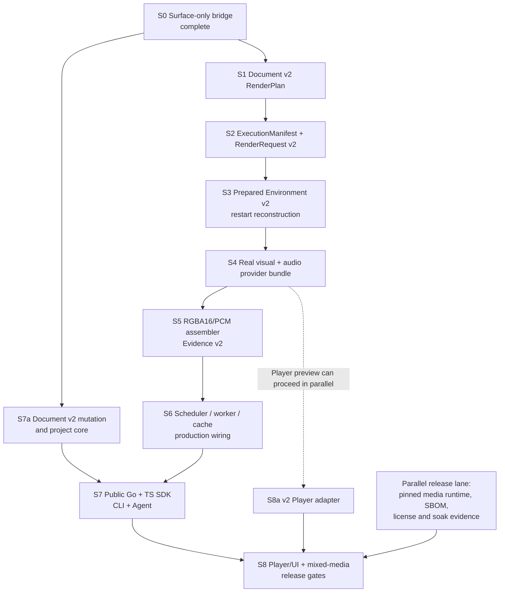

# Cutly Document v2 Native SDK execution plan

Status: handoff-ready execution plan

Updated: 2026-11-07

Implementation branch: `codex/video-sdk-core`

Original handoff base commit: `0a19a82` (`feat: expose host-bound reference surfaces`)

### Standalone execution baseline (2026-11-07)

Implementation continues in Go; the proposed Rust rewrite is deferred. The active standalone
branch is `codex/video-sdk-core`, starting at `f9f891a`. The original handoff SHA `0a19a82` is not
present in this repository's history. Commit `cabbfbb` has the surface-bridge implementation and
subject; this identifies the local code baseline, not a proof of commit equivalence or a rerun of
the historical audit below.

The owner has deferred Manyfy integration work. Execute and validate within standalone Cutly only:
do not edit the sibling consumer, create replacement module files, or run its consumer tests in this
execution scope. Existing Cutly legacy compatibility gates remain mandatory. Manyfy acceptance is
explicitly deferred, not passed, and must be tracked separately from standalone SDK readiness.

Begin with S1 and preserve the stage dependency gates. Save independently reviewable, tested
boundaries as local commits; no push, package publication, tag, or daemon default switch is implied.
S1 acceptance evidence is recorded in `DOCUMENT_V2_S1_EVIDENCE.md`; the active S2 ledger is
`DOCUMENT_V2_S2_EVIDENCE.md`.

## 1. Purpose and completion boundary

This document is the implementation plan for taking Cutly from its current restricted hard-cut RC
and native reference-rendering components to a public, restart-safe Document v2 video-editing SDK.
It is subordinate to the product scope in `docs/CUTLY-SDK-COMPLETE-PLAN.md`, but is deliberately
stored inside the independent `cutly/` module so another agent can execute it without changing the
three owner-authored, untracked planning documents in the parent repository.

The target is the broad M4 boundary:

- native, Chrome-free video/image/vector/static-text/audio rendering;
- durable Document v2 plan, execution manifest and prepared environment;
- chunk scheduling, CAS reuse, checkpoint recovery and isolated workers;
- H.264/AAC MP4 assembly with authenticated Evidence v2;
- public Go and TypeScript SDKs;
- CLI and Agent edit/render lifecycle;
- exact/reference Player preview and headless timeline primitives;
- a real mixed-media end-to-end release gate.

The target is not complete merely because the existing restricted hard-cut RC passes. The legacy RC
and all of its v1/v3 protocols remain supported while the Document v2 path is added in parallel.

## 2. Current authoritative baseline

### 2.1 Implemented and reusable

- exact rational time, frame/sample clocks and stable canonical JSON;
- Document v2 schema, validation, hashing, typed properties, keyframes, transitions and migration;
- frozen evaluator with exact source-time mapping;
- native PNG, vector and pinned-font static-text providers;
- deterministic linear BT.709 premultiplied RGBA16 CPU composition;
- exact AudioGraph and strict WAV reference path;
- deterministic PNG export and live receipt replay;
- host-bound `referencevisualchunk.SurfaceProvider` with canonical binding fixtures;
- backend chunk DAG, CAS primitives, checkpoints and resume contracts;
- restricted FFmpeg hard-cut render path, scheduler, Go/TS RC SDK, CLI and experimental Player;
- fixed protocol fixtures, fault injection and architecture tests across the existing RC surface.

### 2.2 Important gaps that remain

- `core/videoedit.RenderPlan` v3 represents the legacy video/audio model, not the full Document v2
  image/vector/text/transition/AudioBus semantics.
- `render/api.ExecutionManifest` v1 cannot identity-bind a Document v2 visual/audio program.
- `render/prepared.Environment` v1 cannot reconstruct a Document v2 program after restart.
- production `cutlyd` does not wire real Document v2 Surface/PCM providers or a chunk assembler.
- the current reference visual native source path does not yet provide temporal video decode.
- Evidence v1 authenticates decoded RGBA8 output, while pre-codec video chunks are canonical
  RGBA16; changing Evidence v1 would be a compatibility break.
- current durable checkpoints are job-scoped and do not by themselves provide verified cross-job
  warm chunk reuse.
- public Go edit/project/render APIs, TypeScript SDK, CLI, Agent and Player are still primarily on
  the legacy document/render path.

### 2.3 Completed handoff checkpoint

Stage S0 below is complete at `0a19a82`:

- `referencevisual.Program` exposes validated surface-only time/frame APIs;
- `referencevisualchunk.Provider` binds one exact host-owned request and Program;
- V1/V2 image/vector and V2 image/vector/text surface parity is tested;
- non-empty adapter frames, cancellation, panic, nested-target tampering, hostile decode,
  concurrency and resource bounds are tested;
- descriptor and binding canonical fixtures plus fixed hashes are committed;
- package, race, vet, full Go suite and target cross-compilation passed;
- independent final audit: P0=0, P1=0, P2=0.

This bridge is intentionally not a durable render identity. Its binding must not be treated as a
replacement for S1-S3.

## 3. Dependency graph



No stage may skip an upstream identity boundary. In particular, production wiring must not persist
or cache a host-bound live Program without S1-S3.

## 4. Cross-stage invariants

Every implementation stage must preserve these rules:

1. **Additive compatibility.** Do not mutate legacy RenderPlan v3, ExecutionManifest v1,
   Prepared v1, Evidence v1 or their canonical fixtures. Introduce versioned v2 types and codecs.
2. **One source of truth.** Document v2 is canonical; plans and manifests are derived, immutable
   records. No backend, CLI, Agent or Player may invent timeline semantics.
3. **Exact time.** All timeline, source, frame and sample calculations use rational clocks and
   checked integer ranges. No floating-point time enters a fingerprint.
4. **Failure-zero.** Cancellation, panic, malformed input, identity drift, resource exhaustion and
   dependency failure return no partial public value or publishable artifact.
5. **Strict wire format.** Reject duplicate keys, unknown fields, case aliases, noncanonical JSON,
   missing required fields, invalid UTF-8, unsorted sets, overflow and oversized input.
6. **Identity before work.** Recompute and cross-bind Document, plan, manifest, configuration,
   provider, media and content identities before proportional decode/render work.
7. **Host-owned authority.** Agents and callers may not select executable digests, authorization
   roots, worker identities or unsafe locators.
8. **No silent fallback.** An unsupported Document v2 capability produces stable diagnostics; it
   never falls back to a legacy renderer or approximated behavior.
9. **Bounded resources.** Every retained byte, peak working set, chunk spool and canonical record
   has checked admission before allocation or process launch.
10. **Evidence before publication.** Media and evidence are an atomic logical pair; no-replace
    publication and recovery must never expose an unauthenticated artifact.
11. **Owned immutable values.** Public results do not retain caller-owned slices, maps, byte
    buffers, mutable documents or live resource handles.
12. **Manyfy compatibility.** The independent Cutly module never imports Manyfy. Existing Manyfy
    consumers and the restricted RC remain green after every public-boundary change.

## 5. Stage S0 — host-bound reference surface bridge

Status: **complete** at `0a19a82`.

Artifacts:

- `render/referencevisual.RenderSurfaceAt`
- `render/referencevisual.RenderSurfaceFrame`
- `render/referencevisualchunk.Provider`
- canonical descriptor/binding fixtures

Do not broaden this package into a persistence layer. S1-S3 own durable identity and restart.

## 6. Stage S1 — freeze the Document v2 semantic RenderPlan

### 6.1 Objective

Create a deterministic, backend-neutral plan that says exactly what part of one Document v2 will
be rendered. Keep the legacy `core/videoedit.RenderPlan` unchanged.

### 6.2 Proposed package and public shape

Add `core/renderplanv2` with an initial wire schema/profile such as:

```go
const SchemaVersion = 1
const ProfileV1 = "cutly.semantic.document-v2-render-plan.v1"

type PlannedClip struct {
    TrackID, ClipID, AssetID documentv2.ID
    TrackKind                documentv2.TrackKind
    AssetKind                documentv2.AssetKind
    TrackIndex, ClipIndex    int
    TimelineRange, SourceRange               documentv2.TimeRange
    VisibleTimelineRange, VisibleSourceRange documentv2.TimeRange
}

type ResourceRef struct {
    AssetID     documentv2.ID
    Kind        documentv2.AssetKind
    ContentHash string
}

type Plan struct {
    SchemaVersion        int
    Profile              string
    CanonicalJSONProfile string
    DocumentID           documentv2.ID
    Revision             documentv2.Revision
    DocumentHash         string
    TimelineID           documentv2.ID
    RequestedRange       documentv2.TimeRange
    Target               videoedit.RenderTarget
    FrameRange           videoedit.TickRange
    SampleRange          videoedit.TickRange
    RequiredCapabilities documentv2.CapabilityRequirements
    Visual               []PlannedClip
    Audio                []PlannedClip
    Resources            []ResourceRef
    Fingerprint          string
}
```

Exact field types and JSON names must be explicit in source and schema; the sketch above is not a
license to use untyped maps.

Required APIs:

```go
Resolve(ctx, document, requestedRange, target) (Plan, []documentv2.Diagnostic)
Canonical(plan Plan) ([]byte, error)
Decode(raw []byte) (Plan, error)
Verify(plan Plan) (VerifiedPlan, error)
VerifyAgainstDocument(ctx, plan, document) error
```

### 6.3 Semantic rules

- Visual order retains timeline track/clip order and contains video, image, vector and text.
- Audio contains audio-track sources, including audio carried by a video asset when selected.
- Visible ranges are exact intersections projected through the authored source mapping.
- Capability requirements cover only selected, enabled, intersecting clips and transition handles.
- Resources are sorted unique external resources. Inline vector/text payloads remain in the
  Document, while a text asset's indirect pinned font is included in the closure.
- Disabled and out-of-range clips do not enter the executable closure.
- Frame/sample ranges are derived from the same requested range and target clocks.
- The fingerprint covers every semantic field except itself under the canonical JSON profile.
- The Plan references the Document hash but does not embed the Document snapshot; S3 stores it.

### 6.4 Protocol and fixture gate

Add:

- a new `schemas/cutly.document-v2-render-plan.v1.schema.json` with a unique `$id`;
- one minimal gap plan fixture;
- one mixed image/vector/text/audio plan fixture;
- one transition-handle fixture;
- invalid fixture corpus;
- fixed canonical bytes and SHA-256 assertions.

Register the new schema and its valid instance in the conformance offline registry and
`validInstances` inventory. Do not replace or reuse the existing `cutly.render-plan.v2` or v3
schema names. Put valid, invalid and canonical instances under the conformance fixture tree so the
schema, strict decoder and canonical encoder are tested together.

Tests must reject duplicate/unknown/case-aliased fields, noncanonical ordering, duplicate resources
or capabilities, fingerprint tampering, indirect-font omission, range/clock overflow, wrong
Document hash, V1/V2 cross-decode, oversized input and cancellation. Verify ownership and
concurrent read safety.

### 6.5 Suggested commits

1. `feat: freeze document v2 render plans`
2. `test: publish document v2 plan fixtures`

### 6.6 Exit evidence

- focused package, race and vet tests pass;
- all existing Document v1/v2 and RenderPlan v3 fixtures remain byte-identical;
- independent audit has no P0/P1/P2.

## 7. Stage S2 — freeze ExecutionManifest and RenderRequest v2

### 7.1 Objective

Freeze how one verified S1 plan will execute, including authorized resources and exact
visual/audio program selection. Keep ExecutionManifest v1 and RenderRequest v1 unchanged.

### 7.2 Proposed types

Add versioned types in `render/api`:

```go
type BackendCapabilitiesV2 struct {
    BackendID, BuildFingerprint string
    TrackKinds []documentv2.TrackKind
    AssetKinds []documentv2.AssetKind
    Features   []videoedit.CapabilityID
    MaxWidth, MaxHeight int
}

type MaterializedResourceV2 struct {
    AssetID                documentv2.ID
    Kind                   documentv2.AssetKind
    ContentHash            string
    SizeBytes              int64
    LocatorScheme          LocatorScheme
    Locator                string
    MaterializationProfile string
    InspectionFingerprint  string
    ProbeFingerprint       string
}

type ProgramSelectionV2 struct {
    Enabled                   bool
    Profile                   string
    DescriptorFingerprint     string
    Configuration             json.RawMessage
    ConfigurationFingerprint  string
    SourceManifestFingerprint string
}

type IntermediateProfilesV2 struct {
    VideoSurfaceProfile string
    AudioBlockProfile   string
}

type OutputSpecV2 struct {
    ReferenceProfile    string
    Format              string
    Width               int
    Height              int
    PixelFormat         string
    ColorSpace          string
    VideoCodec          string
    AudioCodec          string
    SampleRate          int64
    Channels            int
    Intermediate        IntermediateProfilesV2
    DecodedVideoProfile string
    DecodedAudioProfile string
}

type ExecutionManifestV2 struct {
    SchemaVersion        int
    Profile              string
    CanonicalJSONProfile string
    PlanFingerprint      string
    SemanticProfile      string
    DocumentHash         string
    CompilerBuild        string
    EvaluatorBuild       string
    ProviderBuild        string
    Resources            []MaterializedResourceV2
    Backend              BackendCapabilitiesV2
    MediaRuntime         MediaRuntime
    Output               OutputSpecV2
    Visual               ProgramSelectionV2
    Audio                ProgramSelectionV2
    DeterministicSeed    int64
    Fingerprint          string
}

type RenderRequestV2 struct {
    Job      RenderJob
    Plan     renderplanv2.Plan
    Manifest ExecutionManifestV2
}
```

Use concrete versioned types, not `any`. Program configuration is bounded canonical JSON and has
its own recomputed fingerprint. `OutputSpecV2` is additive: the existing `OutputSpec` and its
validator deliberately freeze final decoded RGBA8/PCM16LE evidence and must not be relaxed.
`IntermediateProfilesV2` separately freezes canonical RGBA16 surface chunks and PCM16LE blocks,
while `Decoded*Profile` continues to describe the final artifact after decode.

### 7.3 Validation rules

- Resource closure exactly equals the S1 plan: no missing, extra, duplicate or substituted item.
- Video/audio resources require a probe fingerprint. Static image/font resources require their
  format-specific inspection fingerprint and must omit the FFprobe fingerprint. Inline vector/text
  resources are not materialized entries. Any other kind needs an explicit versioned rule or stable
  rejection.
- Locator scheme and locator pass the existing secure materialization rules; no traversal, NUL,
  symlink substitution or caller-selected host roots.
- Plan fingerprint, semantic profile and Document hash agree at every level.
- For each enabled Visual/Audio selection, profile, descriptor, config and source-manifest
  fingerprints are mandatory and enter the manifest fingerprint; a disabled selection must omit
  all of them.
- Backend capability sets are sorted unique and satisfy every S1 requirement.
- `ProviderBuild` is a host-owned canonical executable digest. It enters the manifest fingerprint;
  `ChunkAssemblyRequestV2.ProviderExecutableDigest` and every provider/worker receipt must equal it
  exactly. `CompilerBuild` and `EvaluatorBuild` remain separate identities rather than accepting a
  caller-selected free-form provider string.
- RenderJob range is a valid subrange and its frame/sample ranges are re-derived exactly.
- The selected intermediate video profile is canonical RGBA16, while final decoded video remains
  RGBA8; neither field may masquerade as the other.
- `ProgramSelectionV2.Enabled` has a strict canonical contract: enabled selections require every
  identity/config field, disabled selections require those fields absent. Freeze fixtures for gap,
  visual-only, audio-only and silent-output cases; do not let omitted/zero values acquire meaning
  implicitly. A nonempty sample range with no authored audio must select an explicit frozen silence
  provider rather than an ambiguous disabled audio program. Symmetrically, a nonempty frame range
  with no authored visual layer selects an explicit transparent-gap provider.

### 7.4 Protocol and failure gate

Add uniquely named schemas such as
`schemas/cutly.execution-manifest.document-v2.v2.schema.json` and
`schemas/cutly.render-request.document-v2.v2.schema.json`, register them in the offline schema
registry, and freeze valid/invalid/canonical fixtures plus fixed hashes. Add table-driven nested
tamper tests for every resource, backend, target, intermediate/final output profile, configuration
and program-selection field. Reject V1/V2 cross-decode, locator/content mismatch, unsorted sets,
capability gaps, wrong profile, wrong seed, wrong source manifest, noncanonical config, overflow,
cancellation and panic with zero result.

### 7.5 Suggested commits

1. `feat: freeze document v2 execution manifests`
2. `feat: validate document v2 render requests`

### 7.6 Exit evidence

- S1 plan and S2 manifest can be independently decoded and jointly verified;
- the same canonical fixtures are suitable for later Go/TypeScript conformance;
- all v1 manifest/job/evidence fixtures remain unchanged;
- independent audit has no P0/P1/P2.

## 8. Stage S3 — persist and reconstruct Prepared Environment v2

### 8.1 Objective

Persist enough owned, canonical state to prove and reconstruct the same Document v2 render after a
daemon restart. Never serialize a live Program pointer or provider handle.

### 8.2 Storage model

Extend `render/prepared` additively:

```go
type EnvironmentV2 struct {
    Document documentv2.Document
    Plan     renderplanv2.Plan
    Manifest renderapi.ExecutionManifestV2
}

func (s *Store) PutV2(ctx, document, plan, manifest) (EnvironmentV2, bool, error)
func (s *Store) ResolveV2(ctx, planFingerprint, manifestFingerprint) (EnvironmentV2, error)
```

The v2 record includes schema/profile, Document hash, plan fingerprint, manifest fingerprint,
canonical Document snapshot, plan and execution manifest. V1 paths and bytes remain untouched.

### 8.3 Reverification on Put and Resolve

1. strict-decode and canonicalize the Document;
2. recompute Document hash;
3. re-run S1 Resolve and require canonical plan equality;
4. re-freeze/verify S2 and require canonical manifest equality;
5. cross-check all hashes, profiles, ranges and fingerprints;
6. return fully owned values.

Document v2 may reach the existing 128 MiB canonical limit. Do not silently force it through the
v1 64 MiB record ceiling. Define a checked v2 record limit large enough for Document + plan +
manifest, with admission before allocation.

### 8.4 Recovery and hostile-path tests

- `Put -> close -> reopen -> ResolveV2` preserves canonical bytes and identities;
- concurrent/idempotent Put and no-replace collision;
- truncated record, half-write, missing completion marker, corrupt fingerprint and oversize;
- v1 store sees v2 as unsupported and v2 store sees v1 as unsupported;
- caller mutation after Put and returned-value mutation after Resolve do not alter storage;
- cancellation before/after canonicalization, locking and publication;
- symlink/path/owner substitution and panic return no Environment.

Add a canonical record fixture and fixed hash.

### 8.5 Rebuild contract

Add a host-owned reconstruction interface, initially without switching `cutlyd` defaults. The
factory accepts Environment v2 plus an authorized resource source and returns only fully verified
program/provider bindings. It must rehash all content and compare descriptor/config/source-manifest
identities before publication.

### 8.6 Suggested commits

1. `feat: persist document v2 render environments`
2. `feat: reconstruct verified reference programs`

### 8.7 Exit evidence

- restart reconstruction yields the same plan/manifest/program binding and frame hash;
- V1 Prepared tests and fixtures remain byte-identical;
- independent audit has no P0/P1/P2.

## 9. Stage S4 — build the real visual and audio provider bundle

### 9.1 Objective

Turn an S3 Environment into production Surface and PCM providers for the supported M4 Document v2
subset.

### 9.2 Visual provider work

- connect `media/decode`, FFprobe frame index and `render/nativevideo` to a frozen video-source
  provider;
- dispatch image/video/vector/text under one reference visual Program;
- use exact presentation timestamps for VFR selection;
- freeze rotation, sample aspect ratio, YUV range/matrix/transfer/primaries and RGBA16 conversion;
- bind pinned fonts and static-text source manifests;
- reject unsupported HDR, alpha, codec, transition or color semantics during preflight;
- preserve arbitrary-order seek, concurrent calls and immutable surfaces.

### 9.3 Audio provider work

- build sources only from manifest-authorized probe/decoder identities;
- map exact source ranges into AudioGraph;
- apply channel matrix, automation, buses, gain/pan and limiter under frozen profiles;
- render canonical stereo PCM16LE blocks for arbitrary sample ranges;
- implement production `backendstage.PCMProvider` with checked resource estimates.

### 9.4 Golden scenario

Commit a bounded owner-safe fixture bundle containing one Document v2 with:

- temporal video;
- static image;
- vector layer;
- pinned-font static text;
- audio;
- at least one transform/opacity/crop/keyframe and one supported transition.

Freeze probe manifests, provider manifests, RGBA16 surface hashes, output RGBA8 frame hashes and PCM
block hashes. Add explicit supported/rejected VFR, rotation, negative PTS and color cases.

### 9.5 Failure gate

Test locator/probe/content drift, PTS disorder, decode underflow/overflow, wrong frame selection,
font/source replay, channel-order drift, unsupported color, provider panic, cancellation and resource
exhaustion. Every path returns no partial provider/surface/block.

### 9.6 Suggested commits

1. `feat: bind native video sources`
2. `feat: compose mixed document v2 visuals`
3. `feat: render exact reference pcm chunks`

### 9.7 Exit evidence

- the mixed fixture renders stable arbitrary-order RGBA16 frames and PCM blocks;
- preview/export evaluate identical properties and source times;
- independent audit has no P0/P1/P2.

## 10. Stage S5 — assemble canonical chunks and publish Evidence v2

### 10.1 Objective

Implement a real `backendstage.ChunkAssemblerBackend` that consumes verified RGBA16 and PCM16LE CAS
chunks, encodes H.264/AAC MP4, and publishes a verifiable media/evidence pair.

### 10.2 Freeze ChunkAssemblyRequest v2 first

S5 must define the complete assembler input before implementing the backend. Add an additive
`ChunkAssemblyRequestV2` and `ChunkAssemblerBackendV2`; do not reinterpret the existing v1 request:

```go
type ChunkAssemblyRequestV2 struct {
    SchemaVersion                int
    Profile                      string
    JobID                        string
    ArtifactURI                  string
    DocumentHash                 string
    PlanFingerprint              string
    ExecutionManifestFingerprint string
    TimelineRange                documentv2.TimeRange
    FrameRange                   videoedit.TickRange
    SampleRange                  videoedit.TickRange
    Target                       videoedit.RenderTarget
    MediaRuntime                 renderapi.MediaRuntime
    Output                       renderapi.OutputSpecV2
    DeterministicSeed            int64
    ProviderExecutableDigest     string
    Aggregate                    ChunkAggregateBindingV2
    Audio                        []ChunkDescriptorV2
    Video                        []ChunkDescriptorV2
    Fingerprint                  string
}
```

The exact package/types may reuse owned v1 descriptor helpers where their wire semantics are truly
identical, but the v2 request must bind Document, intermediate profiles, plan/manifest, ordered
coverage and provider identity without a dependency on future S6 wiring.
`ProviderExecutableDigest` must exactly equal S2 `ExecutionManifestV2.ProviderBuild`; the assembler
and later worker receipts cross-check the same value.

Add `schemas/cutly.chunk-assembly-request.document-v2.v2.schema.json` with a unique `$id`, strict
decode/verify APIs, offline-registry entry, valid/invalid/canonical fixtures and a fixed canonical
hash. Test every nested field, reordered/duplicate descriptors, range gaps/overlap, aggregate drift,
wrong intermediate layout, wrong output layout, unknown fields, noncanonical JSON, overflow,
oversize, cancellation and panic.

### 10.3 Assembler rules

- accept only descriptors in the verified `ChunkAssemblyRequestV2`;
- read every chunk completely in fixed range/domain order;
- verify size, unit bytes, hash, aggregate root and exact coverage;
- convert RGBA16 to RGBA8 using the frozen output-color profile;
- feed bounded raw video/audio pipes to the pinned FFmpeg runtime;
- restart final codec assembly without recomputing valid pre-codec chunks;
- inspect/recover an existing publication only after complete identity validation;
- publish evidence first under no-replace semantics, then expose the logical pair atomically.

### 10.4 Evidence v2

Add an additive Evidence v2 profile recording:

- Document, plan, manifest, provider, worker and media-runtime identities;
- ordered intermediate RGBA16/PCM chunk descriptors and aggregate roots;
- output color/quantization/codec/mux profiles;
- final decoded RGBA8 and PCM roots;
- artifact hash/size and evidence fingerprint.

Never reinterpret or weaken Evidence v1.

Add `schemas/cutly.evidence-manifest.document-v2.v2.schema.json`, register it in the offline schema
registry, and commit valid, invalid and canonical fixtures with a fixed hash. Its Go decoder must
strictly cross-validate `ChunkAssemblyRequestV2`; S7 later consumes the same vectors in TypeScript
to prove cross-language validation parity.

### 10.5 Fault matrix

Inject short, extra, reordered and tampered chunks; wrong aggregate; encoder kill; broken pipe;
stderr overflow; cancellation; ENOSPC; incomplete evidence; incomplete media; and recovery collision.
Assert there are no staging, media or evidence remnants after failure.

### 10.6 Suggested commits

1. `feat: freeze document v2 chunk assembly requests`
2. `feat: assemble canonical reference chunks`
3. `feat: authenticate document v2 render artifacts`

### 10.7 Exit evidence

- repeated assembly produces the same decoded roots and valid Evidence v2;
- encoder crash reuses existing chunks;
- all fault cases are failure-zero and clean;
- independent audit has no P0/P1/P2.

## 11. Stage S6 — production scheduler, worker and cross-job cache wiring

### 11.1 Objective

Wire S3-S5 into the actual scheduler/daemon with bounded admission, isolated workers, durable resume
and verified cross-job reuse. Keep the legacy FFmpeg adapter as an explicit legacy profile.

### 11.2 Required production wiring

- explicit Document v2 environment source/resolver;
- production `ReferenceChunks` Surface and PCM providers;
- production reference assembler;
- isolated `render/worker` request/receipt protocol, not only goroutines;
- per-task resource admission and private scratch;
- chunk checkpoint replay and missing-range selection;
- worker executable/provenance receipt validation, including exact equality with the manifest's
  host-owned `ProviderBuild`;
- opt-in daemon profile until the full mixed E2E is green.

### 11.3 Cross-job verified cache

Chunk keys already exclude JobID, but job checkpoints are not a global cache index. Add a durable
`chunk key -> verified CAS object + receipt` index with reader lease semantics. On hit, revalidate
profile, identity, size and hash. A corrupt entry evicts/recomputes only that chunk.

### 11.4 Recovery acceptance

- visual/audio worker crash recomputes at most the affected chunk;
- final encoder crash recomputes no valid chunks;
- daemon restart resumes missing work;
- corrupt CAS/index entry is quarantined and recomputed;
- insufficient disk/memory is rejected before starting proportional work;
- cancel becomes terminal within two seconds;
- 100-run fault injection and one-hour local soak show no missing frames, deadlocks or duration-
  proportional retained memory.

### 11.5 Suggested commits

1. `feat: wire document v2 chunk rendering`
2. `feat: reuse verified chunks across jobs`
3. `feat: isolate document v2 render workers`

### 11.6 Exit evidence

- `go list -deps ./cmd/cutlyd` includes the intended v2 provider/worker/assembler packages;
- real daemon restart and fault tests pass;
- legacy RC daemon E2E remains green;
- independent audit has no P0/P1/P2.

## 12. Stage S7 — public Go/TypeScript SDK, CLI and Agent lifecycle

### 12.1 Objective

Expose the same Document v2 edit and render lifecycle across Go, TypeScript, CLI and Agent surfaces
with shared fixtures and no legacy fallback.

### 12.2 S7a prerequisite: Document v2 mutation and project core

Document v2 currently has schema/evaluation/rendering pieces but no equivalent of the legacy
transaction/apply/inverse and hardened local-project engine. Public wrappers must not translate v2
requests back into v1 operations. Add an independent core, for example `core/transactionv2`, plus
an additive `project/localv2` store.

The transaction contract must provide:

- transaction ID, idempotency key and expected revision;
- a closed typed operation union for insert, move, trim, split, delete, retrack, asset/track edits,
  transform/crop/opacity/audio properties, keyframes and supported transitions;
- immutable apply to a candidate Document v2;
- stable diagnostics, render-impact summary and a complete typed inverse;
- revision increment exactly once after successful CAS commit;
- deterministic transaction digest and canonical ownership;
- plan/apply/discard/revert where apply accepts only a previously persisted transaction ID.

The local v2 project store must preserve the existing security properties: clean absolute project
root, symlink/integrity rejection, exclusive lock, revision/hash CAS, journaled atomic no-replace
publication, idempotent replay, crash recovery, immutable history and persisted inverse. Reuse
hardened primitives where appropriate, but do not alias v1 records whose wire semantics differ.

Add `schemas/cutly.transaction.document-v2.v2.schema.json` and any versioned project
plan/commit/history schemas with unique `$id` values. Register valid instances offline and freeze
valid, invalid and canonical fixtures plus hashes. Test every operation and inverse, multi-operation
atomicity, stable IDs, stale revision, duplicate ID/idempotency conflict, invalid property type,
cross-document reference, resource limits, hostile journal/state, concurrent commit, crash at every
publication boundary, reopen/replay, cancellation, panic and mutation ownership.

This prerequisite may be built in parallel with S1-S6, but S7 public edit APIs cannot exit until it
has its own P0/P1/P2-clean audit.

### 12.3 Go SDK

Add public, documented v2 APIs for:

- builders/types and strict decode/hash;
- typed transactions and inspect/plan/apply/discard/revert;
- render plan/prepare/preflight/exact frame/render;
- submit/status/history/cancel;
- artifact/Evidence v2 open and validation;
- strict version negotiation, idempotency and stale-revision handling.

Do not expose internal mutable models or filesystem authority.

### 12.4 TypeScript SDK

Implement matching v2 types/builders and client methods. Consume the exact S1/S2/S3/S5 canonical
fixtures and prove Go/Node hash parity. Test hostile receipts, abort/cancel, unknown versions,
stale revision and packed-package imports. Keep the npm package free of workspace-only imports.

### 12.5 CLI

Make Document v2 the explicit/default new-project profile only after compatibility approval. Add or
complete:

```text
cutly init
cutly inspect
cutly edit plan|apply|discard|revert
cutly render plan|prepare|preflight|frame|submit
cutly render status|history|cancel
cutly artifact verify|open
```

Freeze JSON output, diagnostics and exit codes. Human output is a view over the same typed result.

### 12.6 Agent

- general `cutly_edit` v2 typed operations;
- full render lifecycle and capability discovery;
- plan record review before apply;
- host-owned authorization roots and runtime identity;
- bounded canonical envelopes and stable errors;
- no direct project JSON/HTML rewrite and no caller-controlled executable identity.

Freeze uniquely named Document v2 Agent request/result or action-payload schemas (for example
`cutly.agent-request.document-v2.v2.schema.json` and
`cutly.agent-result.document-v2.v2.schema.json`) with offline-registry entries, valid/invalid/
canonical fixtures and fixed hashes. Go and TypeScript must validate the same vectors. Do not widen
the existing v1 envelope silently.

### 12.7 Migration, API and deprecation deliverables

- generated or hand-maintained API reference for every supported Go, TypeScript, CLI and Agent v2
  entry point;
- a v1-to-Document-v2 migration guide covering canonical document conversion, operation mapping,
  render-profile differences and unsupported features;
- a machine-readable or tested compatibility matrix for legacy RC and Document v2 profiles;
- an explicit SemVer/deprecation policy, including minimum notice and removal rules;
- no default-project/profile switch until owner approval and migration tests pass.

### 12.8 Cross-language acceptance

- Go and Node produce identical hashes for shared fixtures;
- runnable Go and TypeScript mixed-media examples;
- CLI-to-daemon and public-Go-over-HTTP E2E;
- npm tests and `npm pack --dry-run`;
- request/receipt/evidence tamper corpus;
- old Go/TS RC APIs remain source-compatible for their documented profile.

### 12.9 Suggested commits

1. `feat: add document v2 typed transactions`
2. `feat: persist document v2 projects`
3. `feat: expose document v2 go sdk`
4. `feat: expose document v2 typescript sdk`
5. `feat: add document v2 cli and agent actions`
6. `docs: publish document v2 migration and api policy`

### 12.10 Exit evidence

- one project can be edited and rendered through every public surface;
- docs/examples use only exported APIs;
- independent audit has no P0/P1/P2.

## 13. Stage S8 — Player/UI completion and release gates

### 13.1 Player and headless UI

The v2 Player adapter and headless read models may start once S4 frame/audio providers are stable;
they do not need to wait for every S7 wrapper. The release gate still depends on completed S6
runtime recovery and S7 public edit/render contracts.

- connect the Player to v2 exact/reference frame and audio-preview adapters;
- keep proxy preview as a separately declared capability;
- implement deterministic clock, seek, buffering, pause/resume and stale-result rejection;
- expose immutable timeline/track/clip/trim/playhead/selection/waveform/caption primitives;
- make every UI write produce the same typed operations as S7;
- prove preview/export property and source-time parity.

This is a headless/product integration surface, not a requirement to build a full desktop NLE.

### 13.2 Required release E2E

The release gate must execute a real workflow:

```text
init Document v2 project
-> typed mixed-media edits
-> plan
-> prepare
-> preflight
-> exact frame preview
-> chunk render and forced resume
-> H.264/AAC MP4 assembly
-> Evidence v2 validation
-> daemon/project/job/artifact reopen
```

The input must include video, image, vector, pinned-font text and audio.

### 13.3 Release evidence

- ten-run identical decoded video/audio roots;
- golden RGBA16 frame, RGBA8 frame and PCM blocks;
- declared VFR, rotation, negative-PTS and color support/rejection;
- cancellation terminal within two seconds;
- multi-GiB RSS/throughput history and one-hour soak;
- Linux and macOS real-media E2E;
- Windows compile plus stable refusal where a safe handle profile is not implemented;
- signed/pinned FFmpeg and FFprobe bundle identity;
- SBOM, NOTICE, dependency licenses and codec policy;
- Manyfy compatibility smoke;
- standalone Cutly repository sync, checksums and provenance/attestation.
- published API reference, migration guide, compatibility matrix and SemVer/deprecation policy from
  S7, verified against the packaged artifacts.

### 13.4 Suggested commits

1. `feat: connect player to document v2 previews`
2. `feat: expose headless document v2 timeline primitives`
3. `test: prove mixed document v2 sdk end to end`
4. `chore: prepare document v2 sdk release evidence`

### 13.5 M4 definition of done

M4 is complete only when every S0-S8 exit condition has authoritative evidence, all public
protocols have fixed fixtures, the mixed-media E2E passes after restart/fault injection, legacy
profiles remain compatible, and an independent requirement-by-requirement audit finds no required
work missing.

## 14. Per-stage validation matrix

Run focused checks first, then the complete gates before every stage exit.

From `cutly/`:

```bash
go test <changed packages> -count=1
go test -race <changed packages> -count=1
go vet <changed packages>
git diff --check
```

Complete Go gates:

```bash
go test ./... -count=1
go test -race ./... -count=1
go vet ./...
go mod tidy -diff
```

TypeScript gates once S7 is touched:

```bash
npm --prefix sdk/typescript test
npm --prefix sdk/typescript pack --dry-run
```

Cross-target protocol/build gates:

```bash
CGO_ENABLED=0 GOOS=linux GOARCH=amd64 go test -exec=true ./...
CGO_ENABLED=0 GOOS=linux GOARCH=386 go test -exec=true ./...
CGO_ENABLED=0 GOOS=windows GOARCH=amd64 go test -exec=true ./...
CGO_ENABLED=0 GOOS=js GOARCH=wasm go test -exec=true ./...
```

Platform-specific filesystem/process packages may use a documented compatible subset, but pure
protocol packages must pass all four targets.

From the parent Manyfy repository after a public/boundary change, run the complete Go consumer
suite rather than only `internal/` packages:

```bash
go test ./...
```

Also run the explicit Manyfy-to-Cutly consumer smoke/E2E selected for the changed boundary. Run
frontend and desktop builds only when those consumers are deliberately changed. Do not hide
unrelated user changes or stage parent runtime data.

## 15. Commit and audit discipline

- One independently reviewable protocol/behavior boundary per commit.
- Commit fixtures and their validators together.
- Never regenerate a legacy fixture merely to make a new implementation pass.
- Record exact acceptance commands in the commit/PR handoff.
- Before each commit: inspect `git status`, stage explicit paths, run `git diff --cached --check`.
- Before each stage exit: request an independent read-only audit and close P0/P1/P2 findings.
- Do not push, publish npm, tag or switch daemon defaults without owner authorization.
- Do not stage the parent repository's untracked owner documents:
  - `docs/CUTLY-SDK-COMPLETE-PLAN.md`
  - `docs/REMOTION-HYPERFRAMES-SOURCE-AUDIT.md`
  - `docs/VIDEOEDIT-ARCHITECTURE.md`

## 16. Parallel release lane

The following can proceed beside S1-S7 but blocks S8 release:

- owner-approved rollout policy for the remaining restricted RC/M1 gates;
- pinned and signed FFmpeg/FFprobe dependency closure;
- legal/license review, SBOM and NOTICE;
- nightly multi-GiB benchmark/soak history;
- release signing, checksums and provenance.

## 17. Explicitly deferred beyond M4

- Chromium/WebLayer and arbitrary HTML/CSS/JS: M5;
- distributed/cloud orchestration: M6;
- GPU compositor, plugin registry, template ecosystem, OTIO/FCPXML, HDR, ProRes, AV1, rich text
  and broad CSS/JS compatibility: later milestones.

Deferred capabilities must produce stable preflight rejection. They must not be emulated silently.

## 18. Next-agent start instructions

1. Confirm branch `codex/video-sdk-core` and inspect staged/unstaged files; preserve unrelated work.
   Use the standalone baseline above rather than requiring the absent historical `0a19a82`.
2. Read this document, the current stage evidence and existing protocol patterns before editing.
   Manyfy work and consumer tests remain deferred by the owner.
3. S1 is complete; continue S2 additively in `render/api`. Preserve legacy manifest/request/job,
   output/evidence contracts and all existing canonical fixtures.
4. Freeze concrete profiles/types, strict codecs, schemas and minimal canonical fixtures together;
   separate structural identity verification from host-owned execution authorization.
5. Run the full S2 exit gate and obtain independent read-only audit closure before S3.
6. Update the status table below after each stage, including commit IDs and evidence paths.

## 19. Handoff status table

| Stage | Status | Evidence / next action |
| --- | --- | --- |
| S0 Surface bridge | Complete | `0a19a82`; P0/P1/P2=0 |
| S1 Document v2 plan | Complete | `74edd28`, `9db5e5f`, `5e64a65`; final gates passed with documented wasm subset; independent P0/P1/P2 closure in `DOCUMENT_V2_S1_EVIDENCE.md` |
| S2 Manifest/request v2 | Implemented; independent audit blocked | `5bb222d`, `8cb6172`, `66a0b0b`, `0951ad3`; full Go/target gates passed; reviewer service terminated before final closure; see `DOCUMENT_V2_S2_EVIDENCE.md`; do not enter S3 |
| S3 Prepared v2 | Not started | Depends on verified S1/S2 |
| S4 Provider bundle | Not started | Depends on restart-safe S3 |
| S5 Assembler/Evidence v2 | Not started | Depends on real S4 providers |
| S6 Production runtime/cache | Not started | Depends on S3-S5 |
| S7a Mutation/project core | In progress: independent edit/project lane | See `DOCUMENT_V2_S7A_EVIDENCE.md`; does not waive blocked S2 audit; required before public edit APIs |
| S7 Public SDK/CLI/Agent | Not started | Depends on S6 and audited S7a |
| S8 Player/UI/release | Not started | Depends on S6/S7 and parallel release lane |
