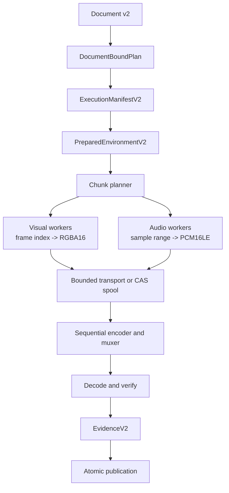

# Cutly native render pipeline enhancement plan

Status: proposed execution plan

Updated: 2026-11-11

Implementation branch: `codex/video-sdk-core`

## 0. Product principle

> **Everything is controlled by the Agent.**

The Agent is Cutly's control plane. It can create and revise Motion code, edit the Document,
select declared capabilities, prepare resources, start or resume renders, inspect evidence and
publish artifacts. The timeline UI, CLI and SDK expose the same typed operations rather than
creating separate sources of truth.

Agent control does not permit ambient or unverifiable behavior. Every operation remains scoped by
user authority and is typed, previewable, reversible where applicable and auditable. The Agent may
choose and orchestrate; the deterministic runtime validates and executes. It may not bypass the
Document binding, manifest fingerprints, resource authorization, sandbox, evidence or publication
rules.

## 1. Decision

Cutly should use a Chrome-free native renderer as its default and reference render path. A browser
must not be the canonical source of pixels, timing, media decode or export correctness. A future
WebLayer may exist as an isolated, explicitly selected capability for HTML/CSS/WebGL content, but
basic editing, text, transitions, composition, audio and final export must work without it.

This decision improves engineering quality more directly than visual richness:

- exact frame/sample evaluation is easier to reproduce and audit;
- cold start, resident memory, process count and offline packaging are more controllable;
- native decode, linear-light composition and canonical RGBA16 intermediates can improve the
  correctness of the image pipeline;
- chunk identities, checkpoints and crash recovery do not depend on browser session state;
- the same semantic evaluator can serve preview, export and evidence generation.

Removing Chrome does **not** automatically make animations, typography or effects look better.
Chrome already provides a mature CSS layout, font, Canvas and WebGL ecosystem. Cutly must earn
visual quality through its own text shaper, compositor, sampling rules, color pipeline, effects and
golden corpus. Therefore the product position is:

> Native-first for deterministic editing and export; optional WebLayer for expressions that truly
> require a browser; never browser-required for the core SDK.

## 2. What to learn from Remotion and Motion Canvas

The useful lesson is their render architecture, not their browser dependency.

### 2.1 Remotion mechanisms worth adopting

Remotion's renderer treats a frame number as the input to visual evaluation. Its documentation
states that multiple browser tabs may render frames and that output must not depend on frames being
evaluated in order. This is the key precondition for safe parallelism and retries:

- <https://www.remotion.dev/docs/flickering>
- <https://www.remotion.dev/docs/renderer/render-frames>

Remotion also overlaps capture with FFmpeg encoding. Its current parallel-encoding path transports
uncompressed frames through shared memory instead of serializing every frame as PNG/JPEG, with an
explicit memory cost:

- <https://convert.remotion.dev/docs/parallel-encoding>

Its public API separates frame rendering, media rendering and frame stitching, which is a useful
boundary for Cutly even though Cutly's implementations will be native:

- <https://www.remotion.dev/docs/api>
- <https://www.remotion.dev/docs/encoding/>

Remotion's WebCodecs client renderer further demonstrates that preview and export can share
composition semantics while using a different backend and exposing a narrower capability set:

- <https://www.remotion.dev/docs/client-side-rendering/>

### 2.2 Motion Canvas mechanisms worth adopting

Motion Canvas renders by advancing a composition frame-by-frame and passing each result to an
exporter. The default exporter can produce an image sequence, while its FFmpeg plugin turns the
same frame stream into video. This is a clean plugin boundary between evaluation and delivery:

- <https://github.com/motion-canvas/motion-canvas/blob/main/packages/docs/docs/getting-started/rendering/index.mdx>
- <https://motioncanvas.io/docs/plugins/>
- <https://github.com/motion-canvas/exporters/blob/main/README.md>

Cutly should likewise keep `evaluate -> compose -> export` separate. Preview scale and export
quality may differ, but timing, property evaluation, source-frame selection and layer ordering must
not.

### 2.3 Adopt / reject matrix

| Mechanism | Cutly decision | Reason |
| --- | --- | --- |
| Frame index deterministically selects a visual state | Adopt as a hard invariant | Enables parallelism, random access and exact retry |
| Frame workers may run out of order | Adopt | Scheduler can scale without changing output |
| Encoder consumes frames in strict order | Adopt | Codec state stays sequential and deterministic |
| Render and encode overlap | Adopt as an opt-in fast profile | Reduces wall time, but requires bounded memory and recovery rules |
| Direct/shared frame transport | Adopt behind a versioned transport profile | Avoids per-frame PNG/JPEG overhead |
| Exporter as a plugin boundary | Adopt | Keeps image sequence, MP4 and future formats outside semantic evaluation |
| Preview/export share semantics | Adopt | Prevents editor/export drift |
| Browser/DOM as canonical pixel truth | Reject | Conflicts with native, auditable, offline reference output |
| JavaScript mutable state or evaluation order | Reject | Breaks arbitrary frame evaluation and recovery |
| Float seconds as the primary clock | Reject | Cutly retains exact rational frame/sample clocks |
| Undeclared fallback between GPU, CPU or browser | Reject | Capabilities and fallback must be frozen in the manifest |
| Persist every frame as PNG/JPEG by default | Reject | Canonical RGBA16 chunks or bounded direct transport are more appropriate |

This is a clean-room design. It adopts general system properties and independently specified
contracts; it does not copy Remotion implementation code or private browser/FFmpeg extensions.

## 3. Target architecture



The stages have different responsibilities:

1. `DocumentBoundPlan` proves the semantic plan was re-resolved from the committed Document.
2. `ExecutionManifestV2` freezes all environment-specific choices, resources and programs.
3. `PreparedEnvironmentV2` is the restartable owned record; it never serializes live handles.
4. Workers evaluate exact frame/sample ranges and publish authenticated intermediate chunks.
5. The encoder receives monotonically ordered frames even if workers complete out of order.
6. Evidence verifies decoded output and records every selected capability and fallback.

## 4. Two execution profiles

### 4.1 `cutly.pipeline.chunked-restartable.v1` — default

Workers publish bounded canonical video and audio chunks into the content-addressed spool. Only
complete chunks with verified headers and content hashes become visible. The assembler then reads
chunks in order and encodes/muxes the output.

Properties:

- restart from the last completed chunk or stage checkpoint;
- safe cross-job reuse when the complete identity tuple matches;
- bounded worker memory and simple failure isolation;
- suitable for desktop, daemon and distributed execution;
- may perform more disk I/O than streaming mode.

This is the reference production profile and the first implementation target.

### 4.2 `cutly.pipeline.stream-encode.v1` — fast path

Visual/audio workers write authenticated blocks to a bounded shared-memory ring or file-backed
spool while the encoder consumes ready ranges in order. A reorder window holds out-of-order worker
results; it never permits the encoder to observe a gap.

Properties:

- overlaps evaluation, composition and encoding;
- avoids writing a complete intermediate image sequence;
- has explicit byte, frame and time limits for the reorder window;
- falls back only through a pre-authorized manifest choice, never silently;
- after encoder failure resumes from an authenticated chunk boundary, not from opaque codec state.

This profile is enabled only after the default profile passes correctness, fault-injection and
memory-pressure gates. It is a performance option, not a separate semantic renderer.

## 5. Lightweight packaging model

Chrome-free rendering is lightweight only if native dependencies are also controlled. Cutly should
ship capability packs rather than one monolithic runtime:

| Pack | Required contents | Loading policy |
| --- | --- | --- |
| Core evaluator | Document v2, exact clocks, property/keyframe evaluator | Always present |
| Reference visual | CPU RGBA16 compositor, image/vector basics | Default |
| Text | Pinned fonts, shaping and rasterization | Load when plan requires text |
| Media | Authorized decoder/prober runtime | Load when plan requires audio/video |
| Encoder | H.264/AAC implementation and muxer | Load for encoded export |
| GPU | Versioned device/backend implementation | Optional declared acceleration |
| WebLayer | Pinned browser/runtime bundle in an isolated worker | Optional explicit capability |

Every loaded pack contributes a build fingerprint to `ExecutionManifestV2`. Package selection must
be derived from the plan closure. The daemon must not start media, GPU or WebLayer processes for a
document that does not require them.

Initial targets should be measured, not guessed:

- cold-start latency to first reference frame;
- idle and 1080p render resident memory;
- installed compressed/uncompressed size by capability pack;
- process count and open handles;
- frames per second and encoder utilization;
- temporary bytes per output minute;
- warm restart and checkpoint-resume latency.

## 6. Non-negotiable invariants

1. `frame N` and sample range `S` are pure functions of the bound plan, manifest and exact index.
2. Evaluating frames in any order produces the same canonical surfaces as sequential evaluation.
3. Preview and export share evaluator semantics; quality profiles may change raster resolution or
   backend, not timeline meaning.
4. Workers receive only immutable, content-addressed resources authorized by the manifest.
5. No worker resolves the current project, ambient fonts, host paths, network content or mutable
   environment during render.
6. Capabilities, runtime builds, color rules, program descriptors and fallback choices are
   fingerprinted before work starts.
7. Intermediate video is canonical premultiplied RGBA16 with an explicit color profile; final
   decoded evidence remains the separately versioned RGBA8 profile.
8. Audio work is expressed as exact sample ranges. Silence is an explicit provider, not an absent
   or ambiguous program.
9. Backpressure is bounded in bytes and work units. A slow encoder cannot cause unbounded frame
   allocation.
10. Cancellation and event-sink failure stop new admissions, drain/terminate owned work and never
    publish a partial artifact as complete.
11. Outputs, checkpoints and cache entries use write-temp, verify, sync and no-replace publication.
12. Browser/GPU output is never claimed bit-exact unless that exact backend/build/profile has a
    passing conformance class.

## 7. Delivery plan

### Gate G1 — independent S1 audit

Before S2 begins, audit the completed `core/renderplanv2` surface. The gate is P0=0, P1=0 and P2=0,
with race, vet, fixture and cross-target checks still passing. Any fix must land as a focused commit
before protocol work proceeds.

### Stage S2 — freeze `ExecutionManifestV2` and `RenderRequestV2`

Additive work in `render/api`; v1 bytes and behavior remain unchanged.

Required types:

- `BackendCapabilitiesV2`
- `MaterializedResourceV2`
- `ProgramSelectionV2`
- `IntermediateProfilesV2`
- `OutputSpecV2`
- `ExecutionManifestV2`
- `RenderRequestV2`

Construction must require `renderplanv2.DocumentBoundPlan`, not a plain `Plan` or `VerifiedPlan`.
The wire request may contain the frozen plan value, but the in-process entry point first rebinds it
to the supplied Document and admits work only with the bound handle.

Proposed API shape:

```go
func FreezeExecutionManifestV2(
    ctx context.Context,
    plan renderplanv2.DocumentBoundPlan,
    draft ExecutionManifestV2,
) (VerifiedExecutionManifestV2, error)

func BindRenderRequestV2(
    ctx context.Context,
    document documentv2.Document,
    request RenderRequestV2,
) (DocumentBoundRenderRequestV2, error)
```

`VerifiedExecutionManifestV2` proves wire integrity. `DocumentBoundRenderRequestV2` additionally
proves that the declaration was re-derived from the authoritative Document, but neither is host
execution authority. S3 reconstruction must authorize roots, rehash resource bytes and attest
runtime/program identities before producing the only handle accepted by execution.

Additional S2 decisions:

- freeze pipeline profile (`chunked-restartable` or `stream-encode`) and transport profile;
- freeze `ProviderBuild`, decoder, encoder, text shaper, color and optional WebLayer/GPU builds;
- include program descriptor, canonical config and source-manifest fingerprints;
- require exact resource closure with format-specific inspection/probe evidence;
- represent transparent visual gaps and authored silence with explicit frozen providers;
- use bounded canonical JSON and strict version-specific schemas;
- reject v1/v2 cross-decode, unknown fields, aliases, duplicates, unsorted sets and overflow.

Suggested commits:

1. `feat: freeze document v2 execution manifests`
2. `feat: bind document v2 render requests`
3. `test: publish document v2 request fixtures`

### Stage S3 — persist and reconstruct `PreparedEnvironmentV2`

Persist canonical Document, plan and manifest with their independent fingerprints. On both Put and
Resolve:

1. strict-decode and hash the Document;
2. re-run S1 resolution and byte-match the plan;
3. re-freeze and byte-match the manifest;
4. re-derive all time/frame/sample ranges;
5. rehash materialized content before publishing live bindings;
6. return fully owned immutable values.

Cover restart, truncation, half-write, collision, mutation, cancellation, symlink substitution,
oversize and concurrent idempotent Put/Resolve.

### Stage S4 — complete native provider bundles

Build a host-owned provider factory from `PreparedEnvironmentV2`:

- temporal video frame decode with exact source-time selection;
- image/vector/static-text surface providers;
- audio decode, resample, mix, automation and explicit silence;
- transparent-gap visual provider;
- pinned color conversion, sampling and alpha rules;
- optional GPU provider with a separately declared determinism class.

The temporal decoder must expose random-access frame requests and be safe under out-of-order worker
evaluation. Decoder caches are performance state only; cache presence must not alter selected
frames or pixels.

### Stage S5 — chunk assembler and `EvidenceV2`

Define independently versioned intermediate headers:

- visual chunk: plan/manifest/program identities, frame range, width/height/stride, pixel/color
  profiles, payload hash and provider receipt;
- audio block: identities, exact sample range, channel layout, sample profile, payload hash and
  provider receipt.

The assembler verifies contiguous coverage, rejects overlap/gaps/substitution and feeds ordered
blocks into a pinned encoder/muxer. It then decodes the artifact under the frozen evidence profile
and emits `EvidenceV2` containing decoded hashes, A/V duration, fallback receipts, warnings, cache
stats, peak memory and runtime identities.

### Stage S6 — scheduler, cache and isolated workers

Implement the default restartable pipeline first:

- deterministic chunk planning from exact ranges;
- lease/checkpoint state machine;
- content-addressed chunk keys derived from all semantic and runtime identities;
- cross-job cache reuse only after complete verification;
- isolated worker protocol with cancellation, heartbeat and bounded messages;
- retry missing chunks only; require forward progress;
- reduce worker concurrency on repeated resource failures;
- atomic assembly and publication.

Then add streaming encode:

- bounded shared-memory/file-backed ring;
- ordered-consumer cursor and finite reorder window;
- producer admission based on byte budget, not only frame count;
- encoder stall detection and cancellation propagation;
- recovery at authenticated chunk boundaries;
- explicit fallback receipt when the manifest authorizes default-pipeline recovery.

### Stage S7 — public SDK, CLI and Agent lifecycle

Expose prepare, preflight, render, resume, cancel, inspect-evidence and exact-frame APIs without
leaking live provider handles. TypeScript consumes the same fixtures and must match canonical bytes
and hashes. Agent commands operate on Document revisions and idempotency keys rather than mutable
session state.

### Stage S8 — Player, UI and release gate

Use the same exact evaluator for preview. Interactive preview may use a lower resolution or a
declared GPU backend, while reference preview uses the CPU profile. UI must show the selected
determinism class and any preview/export backend difference rather than implying pixel identity.

Release requires a real mixed-media fixture containing two videos, audio, pinned text, keyframes
and a transition, rendered repeatedly and after daemon restart with identical reference evidence.

## 8. Failure and recovery contract

| Failure | Required behavior |
| --- | --- |
| Worker exits before chunk publication | Discard temp data and retry the missing chunk |
| Worker publishes a bad hash/header | Integrity failure; quarantine entry; never retry as transient |
| Encoder exits | Preserve verified chunks; restart assembly from a declared boundary |
| Daemon exits | Reopen prepared environment and checkpoints; reverify before resuming |
| Disk budget exhausted | Stop admissions; report resource failure; preserve verified completed work |
| Memory pressure | Reduce worker/reorder concurrency; do not silently change backend/profile |
| GPU/backend lost | Fail unless the manifest pre-authorized an identified fallback |
| Event sink disconnects | Cancel owned work and stop progress publication |
| Cancellation | No final artifact publication; completed immutable cache entries may remain reusable |
| Evidence mismatch | Integrity failure; artifact is not complete or publishable |

Retry classification must remain stable and machine-readable. Retryable failure cannot broaden
resource access or change any frozen identity.

## 9. Verification matrix

### Protocol and ownership

- valid, invalid and canonical fixtures with fixed hashes for every v2 contract;
- strict rejection of unknown/duplicate/case-aliased fields and noncanonical ordering;
- document/plan/manifest/program/resource identity tampering;
- caller and returned-value mutation tests;
- cancellation and panic return zero unpublished values;
- race tests for concurrent read, bind, prepare and chunk evaluation.

### Semantic determinism

- render the same frames sequentially, reversed, shuffled and in parallel;
- compare random-access evaluation with playback-to-frame evaluation;
- verify 24000/1001, 30000/1001 and 60000/1001 frame clocks;
- verify 44.1, 48 and 96 kHz audio without float drift;
- cover trim, speed, hold/linear/eased keyframes, nested composition and transitions;
- assert preview/reference-export semantics with backend-specific pixel tolerances declared.

### Recovery and resource bounds

- fault injection at every stage boundary and publication step;
- missing chunk retry, repeated failure concurrency reduction and no-progress termination;
- daemon restart, worker restart and encoder restart;
- cache collision, corruption, stale lease and concurrent same-key writers;
- encoder stalls, small ring capacity and slow disk/network-free resource sources;
- admission limits before allocation for documents, chunks, surfaces, messages and evidence.

### Performance gates

Benchmark the default and streaming profiles at 720p, 1080p and 4K with 1/2/4/8 workers. Record
wall time, CPU/GPU utilization, peak RSS, temporary bytes, cache hit rate and encoder idle time.
Streaming mode is accepted only when it improves representative wall time without changing decoded
evidence and remains inside its declared memory/disk budgets.

## 10. Immediate next sequence

1. Complete independent S1 audit and close every P0/P1/P2.
2. Freeze the S2 wire schemas and canonical examples before implementation APIs spread.
3. Implement `ExecutionManifestV2` around `DocumentBoundPlan`.
4. Implement request rebinding and hostile-path conformance.
5. Persist/reconstruct v2 environments before wiring any production renderer.
6. Land the default chunked restartable native pipeline.
7. Measure it, then add the bounded stream-encode optimization.
8. Keep WebLayer outside the reference path and add it only through the same manifest/provider
   protocol when a real product requirement justifies it.

## 11. Completion boundary

This plan is complete only when Cutly can render the mixed-media release fixture from Document v2
without Chrome, survive daemon/worker/encoder restarts, resume from authenticated state, publish
verified H.264/AAC output and reproduce the same reference evidence across repeated runs.

The browser remains optional. Native is not a reduced fallback; it is the product's reference
execution model.
